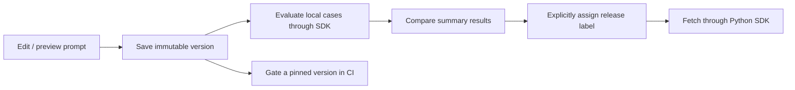
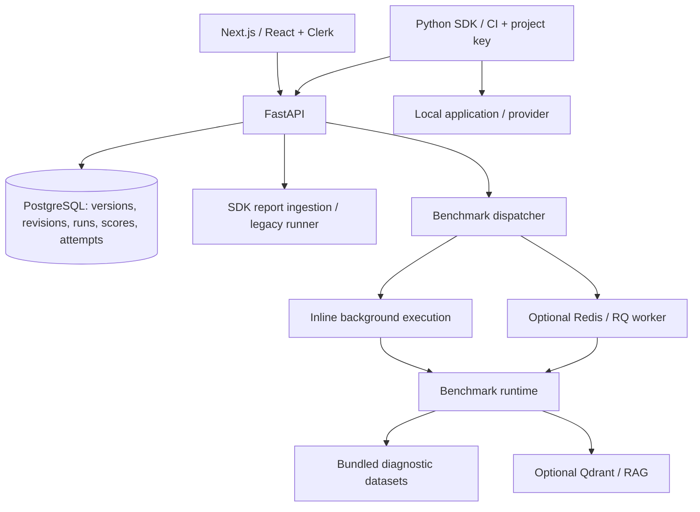

# LLMForge

**Version, evaluate, and release prompts.** LLMForge is a project-scoped workspace for testing prompt changes against locally owned cases before an application or CI job consumes a release.

[](https://github.com/FazlulKarimC/LLM_Forge/actions/workflows/ci.yml)

A prompt that works on one input can regress after a small edit. LLMForge keeps prompt versions immutable and records lightweight summaries of evaluations executed against your local cases. Release labels move only through explicit assignment. A separate Benchmarks area compares reasoning methods.

This is a personal engineering project. The frontend, API and SDK currently declare version **0.1.0**; deployed source/build identities may differ. Demo mode needs no model account and demonstrates workflow correctness rather than real model quality.



## What it supports

- **Prompt development:** text/chat templates, draft playground with up to three model targets, saved JSON config, immutable versions, content/config comparison, tags/folder paths, staging/production/custom labels and automatic latest.
- **Local evaluations:** your application/CI owns cases, provider execution, callbacks and full reports. The SDK uploads content-free summaries with pinned prompt identity, dataset/scoring fingerprints, pass/error counts and optional metrics. Compatible reference summaries can be viewed together.
- **Historical results:** saved hosted runs remain readable. Legacy dataset writes and server-side demo dataset creation are disabled by default.
- **Workspaces and access:** Clerk browser sessions, organization/project isolation, owner-managed hashed project keys with read-only prompt access and explicit optional prompt-write/evaluation scopes.
- **Python SDK and CI:** fetch/compile prompts, evaluate pinned versions locally, upload summary results and run pass-rate gates. The SDK installs from this repository; external results remain self-reported.
- **Reasoning benchmarks:** bounded hosted Naive, CoT and small ReAct runs, per-case progress, Stop/rerun with independent attempt history, frozen baselines, paged inspection and complete JSONL exports. Comparisons use versioned scoring and report missing/unknown cases explicitly. Hosted RAG starts are temporarily paused while retrieval call budgets are added; existing RAG results remain readable.

## Try a provider-free evaluation

1. Sign in and save an `Echo` text prompt with template `{{query}}`.
2. Open **Evaluations → Evaluate with SDK** for the local example; create an evaluation-enabled project key in Settings.
3. Run local Hello/Goodbye cases with the echo task and exact-match callbacks. Upload only the summary.
4. Save prompt v2 as `Reply: {{query}}`, repeat the same local cases/scoring version, and inspect the changed pass counts.
5. Explicitly assign the passing prompt version to production. Local tests do not automatically promote releases.

This example calls no model and checks a deterministic output contract. Replace the task with your application/model client for live testing. [Development](docs/DEVELOPMENT.md#local-sdk-evaluations) includes runnable code.

## Run locally

Use Python 3.12, Node.js 20.9+, PostgreSQL and a Clerk application. The demo needs no Redis, Qdrant or provider key. Commands below use PowerShell:

```powershell
git clone https://github.com/FazlulKarimC/LLM_Forge.git
cd LLM_Forge
python -m venv backend/venv
.\backend\venv\Scripts\Activate.ps1
python -m pip install -r backend/requirements.txt -c backend/constraints.txt
Copy-Item backend/.env.example backend/.env
Copy-Item frontend/.env.example frontend/.env.local
```

Before starting, configure:

| File | Required local values |
| --- | --- |
| `backend/.env` | Development `DATABASE_URL`; matching `CLERK_ISSUER_URL`; `CLERK_AUTHORIZED_PARTIES=http://localhost:3000`; `CORS_ORIGINS=http://localhost:3000` |
| `backend/.env` | `INFERENCE_ENGINE=mock` and `QUEUE_BACKEND_MODE=inline`; leave optional Redis/provider placeholders unset |
| `frontend/.env.local` | `NEXT_PUBLIC_CLERK_PUBLISHABLE_KEY` and `CLERK_SECRET_KEY` from the same Clerk app; `NEXT_PUBLIC_API_URL=http://localhost:8000/api/v1` |

Clerk authenticates users; LLMForge owns organizations/projects in PostgreSQL. Authorized-party origins must match exactly. Review [setup and migration instructions](docs/DEVELOPMENT.md#local-setup) before using an existing database: an older workspace-reset migration deliberately deletes legacy benchmark data.

Start the backend from the activated terminal:

```powershell
cd backend
python -m alembic upgrade head
python -m uvicorn app.main:app --reload --port 8000
```

In another terminal, from the repository root:

```powershell
cd frontend
npm ci
npm run dev
```

Open [localhost:3000](http://localhost:3000), sign in and select a project. `/health` checks API process liveness; `/ready` requires database connectivity and the required schema/capacity row. An idle runner or unavailable optional Redis/Qdrant/provider integration does not make the core app unready. Restart processes after environment changes.

## Use a released prompt or gate a candidate

Install the SDK in an activated Python environment from the repository root:

```powershell
python -m pip install -e ./sdk/python
$env:LLMFORGE_URL = 'http://localhost:8000/api/v1'
$env:LLMFORGE_API_KEY = '<project key from Settings>'
```

```python
from llmforge import LLMForge

with LLMForge() as forge:
    prompt = forge.get_prompt("Echo demo", label="production")
    print(prompt.version, prompt.compile(query="Hello"))
```

Production must be assigned; missing labels return 404 rather than silently selecting latest. For evaluation, keep cases locally and use `evaluate_local` with your task/evaluator callbacks. Upload requires an evaluation-enabled key; read-only keys can fetch prompts. See [local SDK evaluations](docs/DEVELOPMENT.md#local-sdk-evaluations), [method reference](sdk/python/README.md), and [application workflow](docs/examples/evaluation-gate.yml).

## Architecture and current limits



Current evaluation execution runs in your application or CI. LLMForge stores at most a 64 KB summary per submission with validated counts (up to 1,000,000 local cases) and at most 20 finite named metrics. No inputs, reference answers, outputs or provider keys are accepted by the local-report endpoint. History still accumulates; no automatic retention policy has been introduced.

Existing hosted evaluation records/checkpoints are preserved for compatibility. `LEGACY_DATASET_WRITES=false` is the default: dataset create/import/edit/archive and old demo setup return 410. An explicit compatibility switch exists for older integrations/tests; it does not bypass authentication or change the default product. Dataset tables have not been dropped.

Benchmarks retain their separate bundled diagnostic datasets. The hosted profile runs one model job and one provider call at a time, defaults to inline dispatch, and does not require Redis/RQ or Qdrant. Optional dispatch/RAG integrations remain in the code; new hosted RAG execution is paused. The root `data/` duplication is still pending separate cleanup. The SDK remains repository-installed, not published to PyPI. Generic production tracing, online scheduling and hosted dataset authoring are outside the current product scope.

## Development and deployment

[Repository CI](.github/workflows/ci.yml) checks backend/SDK tests, SDK wheel installation, PostgreSQL migrations/locking/HTTP smoke flows, generated contracts and frontend lint/types/tests/build. A successful main-push run invokes the repository's Hugging Face **backend** sync. Frontend deployment is separate; hosted database migrations are not performed by that CI workflow.

The personal deployment uses [Vercel](https://llmforge.vercel.app) for the frontend, [Hugging Face Spaces](https://faz-ai-llm-forge.hf.space) for the API and Neon PostgreSQL. No additional server, queue worker or storage service is required. The [hosted configuration and rollout checks](docs/DEVELOPMENT.md#existing-free-hosting-profile) distinguish repository defaults from deployed settings, including the bounded five-connection runtime pool and the additive benchmark migrations through `r1s2t3u4v5w6`.

Run the appropriate [development checks](docs/DEVELOPMENT.md#testing) for a change. Component tests and local fixtures do not establish authenticated hosted behavior. Backend `/api/v1/version` and frontend `/api/version` expose source/build metadata; unknown metadata cannot establish deployment parity. Avoid fixed test counts as claims of current validation.

## Documentation

- [Architecture and contracts](docs/ARCHITECTURE.md): system/data boundaries, authentication, prompt/evaluation semantics, recovery, benchmarks and API map.
- [Development and operations](docs/DEVELOPMENT.md): setup, demo, SDK/CI usage, tests, contracts, deployment and diagnosis.
- [Frontend design guide](DESIGN_SYSTEM.md): the single source for layout, theme, component, responsive and accessibility conventions.

The backend/frontend/SDK package READMEs cover their local entry points. The public `/docs` route is an end-user walkthrough. Completed plans and audit reports remain in Git history.
