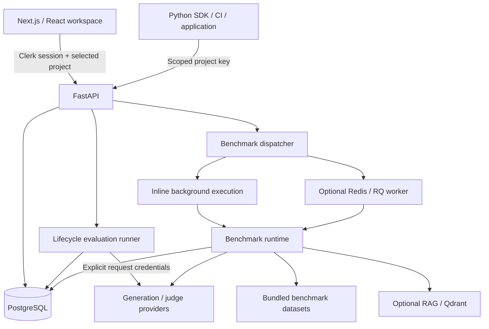

# Architecture and contracts

This document describes the implementation in this repository. [Development](DEVELOPMENT.md) covers setup, validation, SDK use and deployment. [DESIGN_SYSTEM.md](../DESIGN_SYSTEM.md) is the single frontend design guide. Package/API versions currently declare 0.1.0; deployed source/build identities must be checked separately.

## System boundaries

The primary workflow is prompt draft → immutable version → local SDK evaluation → hosted summary comparison → explicit release-label assignment → SDK consumption. Benchmarks remain a separate reasoning/statistics workflow with different execution and dataset paths.

| Area | Implementation |
| --- | --- |
| Frontend | Next.js 16 App Router, React 19, Tailwind v4, TanStack Query, Clerk; `frontend/src/app` and `frontend/src/features` |
| API | FastAPI/Pydantic routes in `backend/app/api`; lifecycle/domain services in `backend/app/services` |
| Persistence | Async SQLAlchemy, PostgreSQL, Alembic; models in `backend/app/models` |
| Durable evaluation state / analytics | `backend/app/repositories`; generation, scoring and reads have separate boundaries |
| SDK | Python 3.10+ HTTPX client, local compiler and CLI in `sdk/python` |
| Contracts | `contracts/openapi.json` and generated `frontend/src/lib/generated/api-schema.ts` |
| Deployment | Vercel frontend configuration; Hugging Face backend container; PostgreSQL configured separately |
| Optional services | Redis/RQ for benchmark dispatch, Qdrant for RAG, provider accounts, Sentry |

React Query owns project-scoped server records. URLs carry shareable selected run/case/filter state. Drafts and credentials stay in editor state. Project/account changes cancel queries, clear scoped caches and retain existing unsaved-change guards. Shared primitives live in `components/ui`; old compatibility exports should not become a second feature implementation.

## Authentication and isolation

Clerk authenticates browser users. The API verifies RS256 signature, issuer, expiry, not-before, user/session identity and exact authorized-party origin, using JWKS or an explicitly configured public key. There is no development auth bypass. LLMForge organizations, memberships and projects live in PostgreSQL independently of Clerk Organizations. Initial authenticated bootstrap provisions the personal organization/project atomically. Owners manage projects and project keys; organization members can access their projects. Inaccessible records/projects return 404.

Dashboard domain routes require a Clerk bearer token and selected `X-Project-ID`. SDK routes use a hashed project key, which determines its project without that header. High-entropy secrets are shown once; only hashes/display prefixes persist. Owner-created keys include `prompts:read`; optional `prompts:write` enables prompt/version creation and label assignment, and `evaluations:write` enables dataset/evaluator reads and evaluation operations. Existing keys do not gain scopes automatically. Keys cannot use dashboard/playground endpoints or edit the evaluator library.

Browser session tokens are not persisted in local storage. Auth recovery refreshes the session or signs in again while preserving the same-origin destination; project selection storage is user-scoped. Revalidate authentication and authorization on every request, including idempotent replays and conditional reads.

## Prompt lifecycle

A stable project-scoped prompt owns immutable versions, current tags and movable labels. Versions contain text or ordered system/user/assistant chat messages, format, bounded JSON configuration, notes, fingerprint and creation source. Type is fixed across versions. Configuration-only edits create versions; identical canonical content/format/config is rejected. Serialized allocation and `base_version` stale checks prevent competing saves. Version creation and requested labels commit atomically. Rename changes the fetch name; archived names remain reserved.

| Selector | Contract |
| --- | --- |
| Omitted | Production; 404 when unassigned |
| `version=3` | Fixed saved v3; 404 when absent |
| `label=latest` | Newest version; cannot be assigned or removed |
| Staging, production, custom label | Explicit case-sensitive assignment; missing labels return 404 |
| Version and label together | 422 |

Saving does not implicitly move production. Rollback assigns an earlier saved version. Folder/name paths are namespaces; tags and catalog filters apply before pagination. SDK prompt reads revalidate ETags on every fetch, preserving immediate label/revocation changes; no offline fallback or TTL refresh is implemented.

Mustache `{{variable}}` and restricted brace `{variable}` substitution are single-pass and do not evaluate code. Brace templates escape literal braces with doubled braces. Variables use identifier syntax; attributes, conversions, format specifications, loops and sections are rejected. Limits: 50,000 template characters, 100 variables, 10,000 characters per input, 100,000 compiled characters. Chat compilation preserves roles. Conversation placeholders, tool/multimodal messages and composition/dependency graphs are not implemented.

Playground preview/generation uses the current draft and up to three model targets with explicit settings. Demo echoes compiled content and is not a quality measurement. Live calls use request-only credentials, a 30-second deadline and a 2,048-token output limit; there are no automatic provider retries/fallbacks. Playground output is not saved as an evaluation run. Local SDK applications explicitly decide how to apply saved generation settings; legacy hosted setup also validates them explicitly.

## Local evaluations and legacy compatibility

### Current local reporting contract

`POST /api/v1/sdk/evaluations/local-reports` accepts an evaluation-enabled project key and a bounded content-free report: pinned prompt version, dataset name, SHA-256 dataset/scoring fingerprints, model label, total/completed/passed/error counts, terminal status and up to 20 finite named metrics. Total supports 1–1,000,000 local cases; completed reports must cover every case and passed+errors cannot exceed processed. Bodies are limited to 64 KB and unknown fields (including inputs, outputs, keys or case arrays) are rejected.

`EvaluationRun.dataset_revision_id` is nullable for this source. Reference metadata lives in the immutable run config (`source=sdk_local`, `reporting=summary`); the service creates no dataset, revision, case, score or execution-checkpoint rows. Summary reports require a project-owned active prompt version. Project locks and actor/operation-scoped idempotency preserve replay/conflict semantics.

The SDK fingerprints canonical selected cases, including stable IDs, inputs, references and metadata, sorted by ID so row order does not change identity. Scoring identity includes explicit user-supplied code/settings version and evaluator names. The backend validates declared hash format, not private content. All scores remain self-reported. References are filtered on both fingerprints; nullable legacy revision IDs are never treated as shared dataset identity.

Local reports are terminal, have zero remaining hosted calls and no resume/re-score action. No per-case or paired-regression claims can be made without case records. Full local artifacts are written before summary upload and remain the source for inspecting inputs/outputs. Detailed local-case uploads, automatic artifact storage and automatic retention are not implemented.

The following hosted dataset/runner contracts describe compatibility for saved records. Dataset writes and old demo creation return 410 unless `LEGACY_DATASET_WRITES=true` is explicitly enabled; browser authoring and new hosted setup are removed from the product.

### Legacy hosted data ownership and imports

The Datasets workspace stores project-scoped `evaluation_datasets` and immutable `dataset_revisions` in PostgreSQL. Editing cases saves a new revision with `base_version` stale checks; archive preserves historical revisions/results while preventing new selections. Dataset names are unique per project.

Each case contains `inputs: dict[str, str]`, optional `name` and nullable string `expected_output`. JSON import accepts an array of those cases. CSV accepts `input.variable` columns or one CSV-quoted JSON `inputs` column, plus `expected_output` and optional `name`; do not mix input styles. Unknown/duplicate headers, malformed/non-string inputs, empty or oversized revisions are rejected. Missing CSV references are null; empty reference cells are empty strings. Import validates/previews only; applying to a draft and saving are explicit operations.

Bundled benchmark files in `backend/data/datasets` are a different schema (`question` / `answer` / aliases and optional evidence/tool fields). They do not automatically appear as project datasets. The root `data/` currently duplicates backend fixtures; both folders remain in the repository pending separate data cleanup. The runtime resolves `settings.data_dir` to `backend/data` locally, or `/app/data` in the flat container. Knowledge-base articles support RAG indexing/synthetic benchmark workflows. No data migration or fixture import is implied by this documentation change.

### Checks, evaluator versions and scores

Inline checks support exact match, contains, regex, valid JSON, JSON equality, per-case JSON reference equality and JSON-path equality. Regex execution is bounded to 50ms. Exact/contains matching preserves case and whitespace. JSON equality ignores object-key order but distinguishes booleans from numbers; JSON paths traverse dot-separated keys/array indexes and compare against a fixed literal. Per-case reference-field matching is not implemented. JSON parsing rejects Markdown fences as part of a strict output contract.

Reusable evaluators have immutable versions containing a built-in check or judge definition, input mappings, score schemas and passing policy. Stale edits preserve the draft; archiving prevents new selections while keeping history. Dispatch pins the evaluator version and full non-secret policy. Built-ins emit a boolean score; judges can emit up to five declared boolean, bounded numeric or categorical scores per call. Missing/wrong-typed judge values are execution errors. Mapping uses case inputs, output and reference; arbitrary server-side evaluator code is unsupported.

All inline checks and required evaluators must pass for a case to pass. Informational scores do not determine pass/fail; their execution errors stay visible. At least one required check/judge/evaluator is necessary. Judge scores are model opinions and remain vulnerable to candidate-content prompt injection; prefer deterministic checks for strict contracts.

Evaluator preview tests a saved version against one supplied sample without creating a run. Judge previews require explicit credentials/calls. Saved-output scoring creates a source-linked run with selected evaluators and zero new generation calls; missing outputs remain errors. Earlier results/scores remain readable, including application-submitted outputs. Source generation usage is historical rather than another charge.

### Legacy hosted providers, limits and comparisons

Public `GET /api/v1/capabilities` advertises the deployed provider contract without database/provider calls. Evaluation generation accepts `mock`, `groq`, `openrouter` and `openai`; judges accept the latter three. These are separate from the benchmark provider registry. Native Gemini is absent: applications can generate externally and submit results.

| Bound | Current value |
| --- | --- |
| Dataset revision | 100 cases, 1 MB |
| Live generation | 50 cases |
| Judging | 20 cases |
| Checks | 10 inline assertions, 10 saved evaluator selections |
| Judges / model calls | At most 2 judges including inline judge; at most 60 model calls per run |
| Capacity | 2 active runs per project, 2 concurrently executing evaluation attempts globally |
| Provider call / output | 30-second deadline; 2,048 tokens and 32,000 output characters |
| External submissions | 1 MB, 100 results, 20 finite named metrics |

Setup validates required inputs, definitions, keys and estimated calls before dispatch. Generation/judge credentials are explicit request-only values; server provider keys are not silently used for evaluation runs. Never persist them in config, fingerprints, query caches, exports or diagnostics.

Results retain separate quality failures, execution errors, missing scores and processed/scored coverage. Pass rate uses all dataset cases; incomplete values are provisional. Numeric/boolean means exclude missing/error scores; categorical scores show counts. Comparisons align case indexes only for the same dataset revision. Changed assertions, judge/provider/rubric/threshold, evaluator version or required policy produce compatibility warnings and disable numeric deltas. Externally supplied scores remain self-reported without pinned evaluator provenance.

### Legacy durable execution and recovery

Creation persists the run, immutable configuration and execution attempt. FastAPI lifespan starts/stops the runner; PostgreSQL owns progress while the accepting process owns credentials bound to that exact attempt. A global capacity row serializes claims; short transactions lock the run and claim attempts with `SKIP LOCKED`. Calls are sequential within each run.

Ownership heartbeats every 15 seconds, expires after 90 seconds, and reconciliation runs every 30 seconds or on a dispatch wake-up. Every provider stage checks ownership before starting. Checkpoint/finalization transactions recheck it under lock so cancelled, expired or superseded owners cannot commit late results or start another call. An in-flight call may still finish and consume credits.

Generation commits before judging. Each evaluator checkpoint and its typed scores commit together; case result/counters finalize once. Recovery skips committed successful/error stages. Ordinary provider/evaluator errors follow the run policy and are not retried by recovery.

Interrupted work has public status `failed`, internal attempt status `interrupted` and recovery metadata. Provider-free work can recover automatically. Live recovery requires **Resume unfinished work** and fresh keys, preserves the same run/results and appends an attempt. Remaining calls are upper bounds: a charged response lost before checkpointing can repeat. Paid work never resumes automatically. Completed, cancelled, ordinary terminal failures and legacy runs without execution records cannot resume. A stopped container cannot execute work; live credentials remain process-bound even when several processes can claim safely.

Admission uses consistent run/parent lock ordering and project `FOR NO KEY UPDATE` (`with_for_update(key_share=True)` in SQLAlchemy), compatible with foreign-key key-share checks. Read-side expiry locks expired candidates and rechecks their state; multi-run reconciliation uses stable run order. Durable writes stay fenced.

`backend/app/core/database_transactions.py` permits at most three fresh-session attempts for database-only transactions explicitly aborted with SQLSTATE `40P01` or `40001`. Provider calls and ambiguous connection failures are never retried automatically. Exhausted aborted execution writes produce interrupted work with `database_interrupted`. Provider computation must remain separate from write retries.

### Dispatch identity and analytical reads

Creation, scoring, submission and resume accept optional `Idempotency-Key` values of 1–128 visible ASCII characters. Records live 24 hours and are scoped by project, authenticated actor and operation. Intent fingerprint and result commit atomically. Same intent replays the resource; changed intent returns 409. Keys exclude credentials. Frontend actions retain identity after uncertain responses; mutations have no automatic HTTP retries.

Summary endpoints exclude full case payloads and expose aggregates/usage/attempt history. Case pages use bounded previews, server filters, totals and comparison totals; opening a case loads its full content. Poll only active runs. New aggregates use typed scores; historical JSON checks remain readable without invented evaluator provenance.

## Benchmarks and optional infrastructure

Benchmarks use `/experiments` routes with Naive, CoT, RAG and ReAct reasoning, built-in diagnostic datasets, provider/model settings, optional saved text prompts and pinned baselines. Chat snapshots use Evaluations; benchmark adapters reject them. Hugging Face, OpenRouter, Groq and OpenAI-compatible routes are supported, including adaptive routing with recorded served provider, reason and estimated cost.

The registry includes sample, trivia, commonsense, multi-hop, math, ReAct, knowledge-base and adversarial diagnostic sets. The bundled 100-question trivia metadata identifies custom-authored data; it is not the full official TriviaQA benchmark. Diagnostic/adversarial examples do not establish representative quality or safety performance.

Benchmark dispatch is best-effort inline FastAPI background execution, or optional Redis/RQ when health and worker heartbeat permit. `QUEUE_BACKEND_MODE=auto` falls back inline for unavailable Redis/worker or an open circuit breaker. Worker heartbeats are written every 30 seconds and considered fresh for 90 seconds. Inline work can be lost on restart; **Stop run** marks a stranded attempt failed and preserves partial results. Workers check interruption between steps; attempt numbers fence old queued jobs from reruns. Evaluation ownership recovery is a separate mechanism.

RAG uses configured local/hosted Qdrant and indexed knowledge-base articles; check collection/embedding availability before inference. Redis and Qdrant are optional for the provider-free prompt evaluation journey.

Results retain per-sample references, provider provenance, context/agent traces, execution manifests, latency/token/cost metrics and exports. Paired comparisons use bootstrap intervals and McNemar's test on discordant correctness pairs; sample coverage, config and provider confounds still matter. A pinned baseline can drive deterministic trajectory regression rules. Agent traces persist in `Run.agent_trace`; sampled-success retention and automatic trace TTL are not implemented.

Optional benchmark judging samples 20 outputs by default, capped at 50 by its service. It is distinct from versioned dataset evaluators and does not establish objective quality. No provider model is guaranteed to remain free or available.

| `config.optimization` field | Default | Behavior |
| --- | --- | --- |
| `enable_batching` | false | Concurrent compatible-method calls; ReAct remains iterative |
| `batch_size` | 8 | 1–32; choose according to rate limits |
| `enable_caching` | false | Exact prompt/config LRU reuse within one execution |
| `cache_max_size` | 256 | 16–2048 entries |
| `enable_profiling` | true | Persist phase/cache/batch timings |

The runtime creates cache/profiler per execution. Cache keys include prompt, model, max tokens, temperature and seed; there is no semantic similarity or shared cross-run/worker cache. `GET /api/v1/results/{experiment_id}/profile` reads `Result.raw_metrics["optimization"]` when present. Disclose caching when interpreting repeated samples; no fixed throughput gain is guaranteed.

## API and source map

Exact request/response schemas live in [OpenAPI](../contracts/openapi.json). FastAPI exposes its schema at `/api/v1/openapi.json`.

| Prefix / endpoint | Purpose |
| --- | --- |
| `/api/v1/workspaces` | Bootstrap/memberships, organizations and owner-created projects |
| `/api/v1/project-keys` | Owner-managed hashed keys and explicit scopes |
| `/api/v1/prompt-library` | Catalog, drafts/metadata, immutable versions, labels, compile/playground |
| `/api/v1/datasets` | Deprecated compatibility reads; writes default to 410 |
| `/api/v1/evaluators` | Definitions, immutable versions, archive and saved-version preview |
| `/api/v1/evaluations` | Run admission/history, summary, cases, score, cancel and resume |
| `/api/v1/sdk/prompts` | Key-scoped prompt fetch/list/write/label operations |
| `/api/v1/sdk/evaluations` | Local report ingestion plus legacy key-scoped reads/execution |
| `/api/v1/demo/setup` | Deprecated hosted demo creation; default 410 |
| `/api/v1/experiments`, `/api/v1/results` | Separate benchmark lifecycle, inspection, comparison and jobs |
| `/health`, `/ready` | Process liveness; required database/dispatch/runner plus optional dependency state |
| `/api/v1/capabilities`, `/api/v1/version` | Public evaluation support and backend release metadata |
| Frontend `/api/version` | Frontend source/build identity |

Prompt lifecycle/compiler sources are `prompt_service.py` and `prompt_templates.py`. Evaluation admission, execution and recovery live in `evaluation_runs.py`, `evaluation_service.py`, `evaluation_runner.py`, `evaluation_recovery.py` and execution repositories. Benchmark runtime, cache/statistics/judging and RAG live in their separate services. SDK methods/examples are documented in the [package reference](../sdk/python/README.md).

## Diagnostics, rollout and scope

Platform JSON diagnostics allow only request/project/run/attempt/case IDs, stage, duration, outcome, status, exception type, SQLSTATE and retry-attempt fields. They exclude secrets, prompts, outputs and arbitrary exception context. Safe codes/attempt history appear in the product; optional Sentry is sanitized operational error reporting, not general customer tracing.

`/ready` requires database/migration availability, usable dispatch (including inline fallback) and a healthy evaluation runner; optional Qdrant/provider/Redis degradation is reported separately. It does not prove live credential validity or model success.

Migrate each target database before deployment. The workspace-reset migration `i2j3k4l5m6n7` intentionally truncates legacy benchmark tables; review it before migrating existing data. Later additive migrations introduce prompt/SDK/evaluator/durable records, with guards against lossy downgrade. Preserve new records on rollback. CI validates a disposable database, not the hosted database.

Generic production tracing, online scheduling, human-review queues, variant matrices, stable dataset-item identities, conversation placeholders/composition, protected-label approval policies, arbitrary uploaded server code and per-metric CI gates remain extensions. Current capabilities and bounds should be updated here when their implementation changes; avoid adding another phase/audit document as a competing specification.
